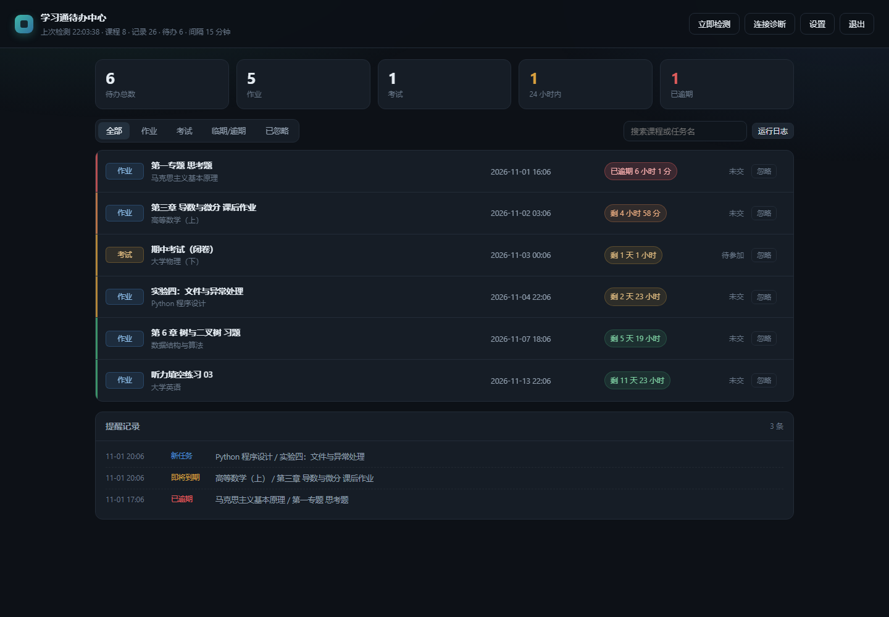
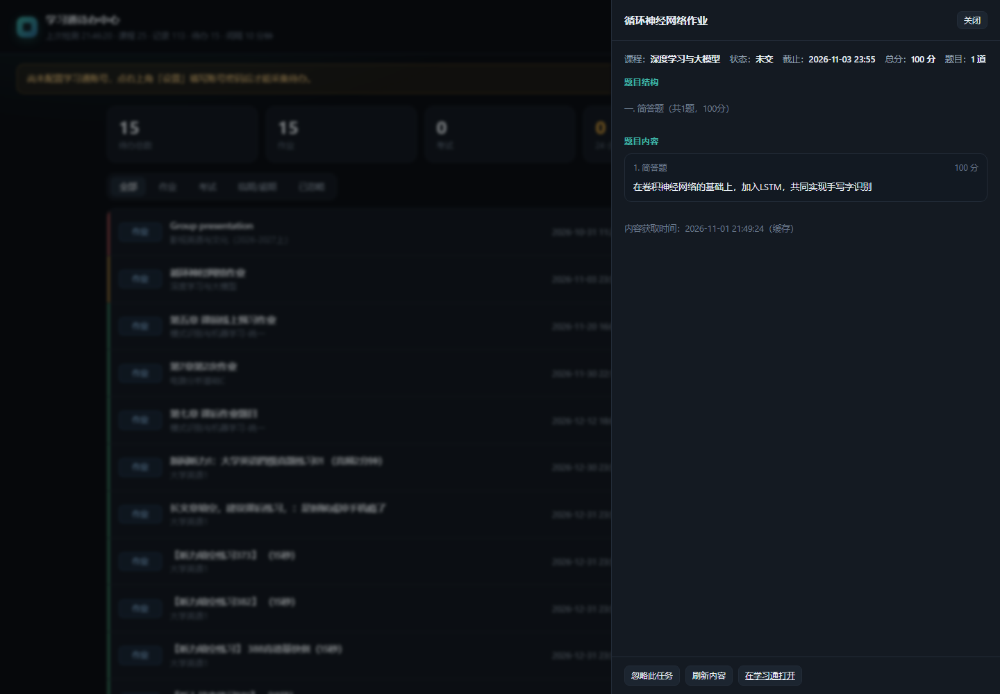

# 学习通作业中心 · Chaoxing Homework Hub

自托管的「学习通（超星）」待办聚合与提醒系统：登录一次，自动汇总全部课程的**未交作业**与**待参加考试**，按剩余时间分级提醒，并提供一个可以直接点开看题目内容的网页面板。

> Self-hosted dashboard & reminder for Chaoxing (学习通): aggregates pending homework and upcoming exams across all your courses, reminds you before deadlines, and lets you read the assignment content in one click.



## 功能

| 能力 | 说明 |
| --- | --- |
| 自动登录 | 复刻网页端口令 AES 加密调用登录接口；登录态缓存，失效自动重登；支持粘贴 Cookie 兜底验证码场景 |
| 待办聚合 | 遍历全部课程，抓取作业与考试，输出课程名、任务名、截止时间、剩余时长、状态 |
| 双平台 | 学习通（超星）+ 长江雨课堂，两个来源合并到同一个看板，任务上标注来源 |
| 作业内容 | 点开任务即可查看题目结构、题干、选项、分值、附件（按需拉取 + 6 小时缓存） |
| 分级提醒 | 新任务即时提醒；剩余 72h / 24h / 3h 各提醒一次；逾期提醒一次；每日定时汇总 |
| 手动忽略 | 单条任务忽略后不再计入统计、不再推送，可随时恢复 |
| 多渠道推送 | 企业微信 / 钉钉机器人、Server 酱、PushPlus、通用 Webhook、SMTP 邮件、终端输出 |
| 网页面板 | 深色仪表盘、倒计时、筛选搜索、连接诊断、运行日志、在线改配置 |
| 命令行模式 | 不装 Web 也能跑：`python -m cxreminder run` 常驻轮询 |
| 可测 | 23 个单元测试覆盖时间解析、列表解析、详情解析、去重与提醒决策 |



## 架构

```
浏览器 ──HTTPS──> nginx ──> uvicorn(127.0.0.1:8000) ──> app/  路由 / 鉴权 / 调度线程
                                                    └──> cxreminder/  采集与提醒内核
                                                              │
                                                              └──> 学习通站点
```

- `cxreminder/` 是纯 Python 内核，命令行与 Web 共用同一套采集、去重、提醒逻辑；
- Web 层只负责鉴权、调度、展示，不重复实现业务规则；
- 状态、Cookie、忽略清单、详情缓存都落在 `data/` 下的 JSON 文件里，无数据库依赖。

```
.
├── chaoxing-reminder/          # 采集与提醒内核（学习通 + 雨课堂，可独立使用）
│   ├── cxreminder/
│   │   ├── client.py           # 登录、Cookie 缓存、课程与待办抓取、详情抓取
│   │   ├── parsers.py          # 课程/作业/考试/详情解析（纯函数，可单测）
│   │   ├── runner.py           # 轮询主循环、提醒决策、汇总落盘
│   │   ├── state.py            # 去重状态（原子写入 + 损坏自动备份）
│   │   ├── notify.py           # 多通道推送
│   │   └── cli.py              # run / once / doctor / dump / test-notify
│   ├── tests/                  # 单元测试
│   └── config.example.yaml
├── chaoxing-web/               # Web 面板
│   ├── app/                    # FastAPI 路由、引擎、鉴权、前端静态页
│   ├── deploy/                 # systemd、nginx 站点、宝塔注册 SQL
│   └── README-DEPLOY.md        # 部署与排障记录（含接口逆向过程）
└── docs/images/                # 截图
```

## 快速开始

需要 Python 3.9+。

### 一、命令行版（只要提醒）

```bash
cd chaoxing-reminder
pip install -r requirements.txt
cp config.example.yaml config.yaml      # 填账号密码，或设环境变量 CX_USERNAME / CX_PASSWORD

python -m cxreminder doctor -c config.yaml       # 自检：依赖/登录/课程数/待办数
python -m cxreminder once   -c config.yaml       # 跑一轮看结果
python -m cxreminder run    -c config.yaml       # 常驻轮询
```

### 二、Web 版（推荐）

```bash
cd chaoxing-web
pip install -r requirements.txt
cp ../chaoxing-reminder/config.example.yaml config.yaml

# 本地试跑（把内核加到 PYTHONPATH）
uvicorn app.main:app --host 127.0.0.1 --port 8000
```

打开 <http://127.0.0.1:8000>，初始访问口令在首次启动时生成，写入 `data/web_password`。
登录后进入「设置」填写学习通账号，点「立即检测」即可。

线上部署（nginx + systemd + 证书 + 宝塔面板建站）见 [chaoxing-web/README-DEPLOY.md](chaoxing-web/README-DEPLOY.md)。

## 配置要点

| 配置项 | 默认 | 说明 |
| --- | --- | --- |
| `account.username` / `account.password` | — | 学习通账号；建议用环境变量 `CX_USERNAME` / `CX_PASSWORD` |
| `poll.interval_seconds` | 900 | 轮询间隔（秒），最小 30 |
| `poll.daily_summary_at` | `08:30` | 每日汇总时间，留空关闭 |
| `remind.thresholds_hours` | `[72, 24, 3]` | 分档提醒阈值，每档只提醒一次 |
| `yuketang.cookie` | 空 | 雨课堂 `sessionid`（只能用 Cookie 登录），配好后自动启用 |
| `notify.channels` | console | 可叠加多个通道，逐个发送，互不影响 |
| `remind.ignore_status_keywords` | 已交/已完成/已批阅/已互评… | 命中即视为已完成，不再计入待办 |

完整注释见 [config.example.yaml](chaoxing-reminder/config.example.yaml)。

## 两个值得记录的坑

1. **作业列表需要课程级 `enc` 令牌**
   `GET /mooc2/work/list` 只带 `courseId/classId/cpi/ut=s` 会返回「无权限的操作！」。
   正确做法是先访问课程中间页 `mooc-ans/visit/stucoursemiddle`，从课程主页隐藏域里取
   `workEnc` / `examEnc` / `openc`，再请求列表（考试接口还多一个 `/exam-ans` 前缀）。
   细节与抓包过程见 [README-DEPLOY.md §8](chaoxing-web/README-DEPLOY.md)。

2. **题型归属**
   详情页里 `typeName="简答题"` 位于 `id="question…"` **之前**，按 id 切块会把下一题的题型算到当前题上；
   改为优先取所属大题标题（`一. 简答题（共1题，100分）`）回填。

## 测试

```bash
cd chaoxing-reminder && python -m unittest discover -s tests -v
```

覆盖：时间解析（中文格式 / 跨年 / 关键字优先级）、课程列表、作业与考试条目、详情题目与选项、
任务指纹稳定性、首轮基线、阈值去重、逾期只报一次、状态跨实例恢复、汇总渲染。

## 免责声明

本项目仅用于**整理你自己账号的待办**，请遵守所在学校的规定与学习通服务条款：

- 不要用于批量爬取、代做代考、刷课等违规用途；
- 脚本自带请求限速与随机抖动，请勿把轮询间隔调到 30 秒以下；
- 账号密码保存在你自己的机器上（`config.yaml`，权限 600），仓库中不含任何凭据；
- 因使用不当造成的账号风险或后果由使用者自行承担。

## License

[MIT](LICENSE)
